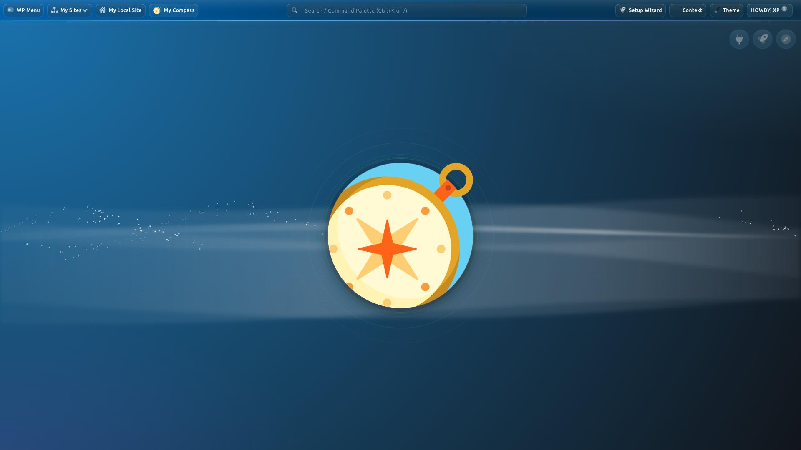

<p align="center">
  
</p>

<h1 align="center">My Compass Engine</h1>

<p align="center">
  <strong>It's dangerous to go alone.</strong><br/>
  A starship-style control deck for WordPress. It replaces the stock wp-admin with a dark, glassmorphic single-page app and is the hub of the My Compass Suite.
</p>

<p align="center">
  <a href="https://github.com/HalloftheGods/xophz-compass">Repository</a> ·
  <a href="docs/CHANGELOG.md">Changelog</a> ·
  <a href="CONTRIBUTING.md">Contributing</a> ·
  <a href="https://www.hallofthegods.com/">Hall of the Gods, Inc.</a>
</p>



---

## Contents

- [What it is](#what-it-is)
- [Highlights](#highlights)
- [How it works](#how-it-works)
- [Requirements](#requirements)
- [Installation](#installation)
- [First run](#first-run)
- [Using the deck](#using-the-deck)
- [Mobile and the WordPress menu](#mobile-and-the-wordpress-menu)
- [Shortcodes](#shortcodes)
- [REST API](#rest-api)
- [Configuration: connectors and keys](#configuration-connectors-and-keys)
- [Security](#security)
- [Progressive Web App](#progressive-web-app)
- [The My Compass Suite](#the-my-compass-suite)
- [Architecture](#architecture)
- [Development](#development)
- [Testing](#testing)
- [Troubleshooting](#troubleshooting)
- [FAQ](#faq)
- [Contributing](#contributing)
- [License](#license)

---

## What it is

My Compass turns WordPress into a command center. Instead of the stock admin screens, you get a single-page app (SPA) mounted inside wp-admin. It talks to WordPress through the REST API, so navigation, tools, dashboards and widgets all live in one interface with a consistent dark theme, neon-cyan accents and glass panels.

The front end is **Vue 3** with **Vuetify 3**, **Pinia** and **Vue Router**, plus a shared component library of `x-*` atoms. The plugin is the foundation: it deploys the UI, the REST surface and the security layer, and it hosts **Sparks**, self-contained apps that plug into the deck.

Compass is the base layer of the **w⁴ Protocol** and **YouMeOS** network.

## Highlights

| Feature | What you get |
| --- | --- |
| **Starship UI** | Dark-first design with glassmorphic panels, animated backgrounds and a collapsible navigation drawer. |
| **Single-page tools** | Each tool is a lazy-loaded hash route, so the deck stays fast. Only the dashboard loads eagerly. |
| **Command palette** | `Ctrl+K` or `⌘K` to search routes and run commands, including inside embedded views. |
| **WordPress menu toggle** | Show or hide the native WordPress menu on demand. Desktop remembers your choice. |
| **Vanity routes** | `/my-compass` and `/compass` send visitors to login, then into the dashboard. |
| **Installable PWA** | Dynamic manifest and service worker endpoints with official icons. |
| **Connectors** | Credentials are declared once and resolved from environment variables, then constants, then saved options. |
| **Hardened REST layer** | Capability checks, nonce enforcement for SPA calls, and masked secrets in every response. |
| **Sparks and companion plugins** | Install extra plugins to add routes, widgets and data to the deck. |

## How it works

```
 Browser (wp-admin)
   └── #app  (Vue 3 SPA, built into admin/dist)
         │   REST calls with X-WP-Nonce
         ▼
 WordPress REST API
   ├── xophz/v1           core deck: site settings, connectors, sparks, modules, matrix, passport, telescope …
   ├── xophz-compass/v1   login, polls, web push, integrations, subscriptions, view tracking
   └── compass/v1         constellations
         │
         ▼
 Companion plugins (Sparks and Suite apps) and the blackbox-bedrock MU plugin
```

Opening `wp-admin/admin.php?page=xophz-compass` loads the built SPA from `admin/dist/`. Routes inside the app use hash history, so `#/bomb-bag` or `#/bazaar/pos` never reach the server.

## Requirements

- **WordPress 7.0 or newer.** Compass registers its credentials with the WordPress Connectors API.
- An administrator account (`manage_options`) for setup and connector management.
- A current desktop or mobile browser.
- For development: Docker, Node.js with pnpm, and the Elysium monorepo this plugin lives in.

## Installation

### From the repository

```bash
cd wp-content/plugins
git clone https://github.com/HalloftheGods/xophz-compass.git
```

Then activate **My Compass Engine** under **Plugins**.

### From a release

1. Download the `xophz-compass` release archive.
2. In wp-admin, go to **Plugins → Add New → Upload Plugin**, choose the archive, and install it.
3. Activate **My Compass Engine**.

### What activation does

- Registers the REST routes and custom post types.
- Deploys the companion MU plugin layer (`blackbox-bedrock`), which keeps Compass styling and WordPress hooks working together.
- Registers the Connectors that hold your credentials.

## First run

1. Open **My Compass** from the admin menu, or visit `/my-compass` on your site.
2. Log in if prompted. Compass takes you to the dashboard.
3. Complete the onboarding flow to set your site identity, language, timezone and default role.
4. Use the **WP Menu** toggle in the top bar if you need the stock WordPress menu.
5. Press `Ctrl+K` (or `⌘K`) to open the command palette.

## Using the deck

Everything in the deck is a **tool**, a hash route that maps to a folder in the SPA. You can reach a tool from the navigation drawer, the command palette, or a direct link such as `wp-admin/admin.php?page=xophz-compass#/bazaar`.

Some of the routes that ship with the core app:

`compass` · `bazaar` · `bomb-bag` · `bugnet` · `bulletin-board` · `enchanted-mirror` · `enchiridion` · `event-horizon` · `fresh-mints` · `gale-boomerang` · `gatekeeper` · `golden-keys` · `hookshot` · `lead-magnet` · `lit-lamp` · `magic-cloak` · `magic-formula` · `magic-wand` · `alphabet-soup` · `midnight-nerd` · `mirror-shield` · `moving-castle` · `my-planner` · `pegasus-boots` · `phantom-zone` · `phone` · `pixie-dust` · `polos` · `produce` · `profile` · `questbook` · `silver-arrow` · `system` · `telescope` · `thors-hammer` · `titans-mitt` · `treasure-map` · `treasure-trove` · `xp` · `yellow-links`

Some of these routes may depend on companion plugins being installed. Each route's folder in the app is the source of truth for what it does.

## Mobile and the WordPress menu

On phones (≤ 782px) Compass starts with the WordPress menu **closed**, so the deck is never pushed aside by a menu you did not open. Tap the **WP Menu** toggle in the top bar to open it. When open, the menu takes a fixed column on the left and the Compass app shifts to its right, so the top bar and its buttons stay on screen.

On desktop, the WordPress menu toggle is remembered, so Compass opens the way you last left it.

## Shortcodes

| Shortcode | Notes |
| --- | --- |
| `[compass_suite]` | Registered by the core plugin. |
| `[compass_plugins]` | Registered by the core plugin. |
| `[compass_catalog]` | Catalog shortcode. See `docs/spec-compass-catalog-shortcode.md`. |
| `[compass_3d_block]` | 3D block shortcode. |

## REST API

Compass uses three REST namespaces. Routes check capabilities or a valid nonce, and responses never include stored secrets.

### `xophz/v1`, the core deck

| Route | Purpose |
| --- | --- |
| `/site-settings` | Site identity, language, timezone and date formats. Admin-only fields need `manage_options`. |
| `/connectors` | Read and write declared credentials. Requires `manage_options`. Values come back masked. |
| `/client/onboard` | Onboarding flow. |
| `/abilities` | What the current user can do in Compass. |
| `/license/verify` | Verifies a license key. |
| `/sparks`, `/sparks/{id}`, `/docs/sparks/{id}` | List and fetch Sparks and their docs. |
| `/modules`, `/modules/install` | List and install modules. |
| `/matrix/departments`, `/matrix/users` (and per-id routes) | Departments and users, including password reset. |
| `/passport`, `/passport/pin`, `/passport/public/{user_id}` | Passport profile and PIN. |
| `/telescope/sites`, `/telescope/navigate`, `/telescope/check-frame`, `/telescope/favorite` | Telescope browsing. |
| `/perform/widgets`, `/perform/pinned` | Dashboard widgets and pinned items. |
| `/gemini/generate` | Text generation through the Gemini connector. The key is sent in a header, never in the URL. |
| `/stripe/checkout` | Creates a Stripe checkout session. |
| `/system/telemetry` | System telemetry for the deck. |

### `xophz-compass/v1`, login, engagement and integrations

| Route | Purpose |
| --- | --- |
| `/login`, `/logout`, `/lostpassword`, `/me` | Authentication for the SPA and the vanity login. |
| `/polls`, `/polls/{id}/vote` | Polls and voting. |
| `/push/public-key`, `/push/subscribe`, `/push/unsubscribe`, `/push/test`, `/push/generate-keys` | Web push. The private key never leaves the server. |
| `/subscriptions` | Subscription status. |
| `/track-view` | View tracking. |
| `/integrations/status`, `/integrations/sync-forminator`, `/integrations/sync-hustle` | Forminator and Hustle sync. |

### `compass/v1`, constellations

| Route | Purpose |
| --- | --- |
| `/constellations` | Constellation data for the deck. |

## Configuration: connectors and keys

Credentials are stored through WordPress **Connectors**. Each connector declares a saved option and the environment variable and constant it accepts. Resolution order is always:

1. The declared **environment variable**
2. The declared **PHP constant**
3. The saved **option**

Set environment variables or constants in production so keys stay out of the database.

| Connector | Option | Environment / constant |
| --- | --- | --- |
| Gemini | `google_gemini_api_key` | `GEMINI_API_KEY` |
| Stripe | `stripe_secret_key` | `STRIPE_SECRET_KEY` |
| Wizard | `compass_wizard_key` | `COMPASS_WIZARD_KEY` |
| API gateway | `compass_gateway_token` | `COMPASS_GATEWAY_TOKEN` (sent as `X-Compass-Gateway-Key`) |
| Web push, public key | `compass_vapid_public_key` | `COMPASS_VAPID_PUBLIC_KEY` |
| Web push, private key | `compass_vapid_private_key` | `COMPASS_VAPID_PRIVATE_KEY` |
| Web push, subject | `compass_vapid_subject` | `COMPASS_VAPID_SUBJECT` |

Example `wp-config.php` entries:

```php
define( 'GEMINI_API_KEY', 'your-key-here' );
define( 'COMPASS_VAPID_PUBLIC_KEY', 'your-public-key' );
define( 'COMPASS_VAPID_PRIVATE_KEY', 'your-private-key' );
define( 'COMPASS_VAPID_SUBJECT', 'mailto:you@example.com' );
```

> If an environment variable or constant sets the VAPID private key, the UI cannot regenerate it and returns `409 vapid_keys_pinned`. Manage that key where it is pinned.

## Security

- **Least privilege.** Connector management and site-level settings require `manage_options`.
- **SPA request guard.** Admin-ajax handlers the SPA calls go through `Xophz_Compass_Security::enforce_spa_ajax()`, which verifies the `wp_rest` nonce and capability. A stale nonce returns `rest_cookie_invalid_nonce`, which the SPA refreshes and retries.
- **Plugin actions.** Activating or deactivating a plugin from the SPA requires `activate_plugins`, a valid nonce, and a plugin path of the form `<slug>/<slug>.php`.
- **Write allow-list.** The connectors endpoint only writes setting names that registered connectors declare. Anything else returns `400 xophz_connector_unknown_setting`, and that request writes nothing.
- **No secrets in responses or logs.** Credentials come back masked (last four characters). Gemini keys travel in headers, not URLs. The VAPID private key stays server-side.
- **Bundle hygiene.** The monorepo build fails if a secret-named environment value would be inlined into the admin bundle (`scripts/vite-secret-guard.js`).
- **Locked-down helpers.** `test-rest.php` answers `404` unless it runs from the PHP CLI.

To report a vulnerability, contact the maintainers privately instead of opening a public issue.

## Progressive Web App

The admin can be installed as a PWA:

- A dynamic Web App Manifest at `/wp-json/xophz-compass/v1/admin-manifest`.
- A service worker at `/wp-json/xophz-compass/v1/admin-sw`, served with `Service-Worker-Allowed: /wp-admin/`.
- Official Compass icons (`icon.png`, 512×512, and `icon.svg`) and theme color `#1a1e22`.
- Early capture of the install prompt, so the deck can offer install at the right moment.

## The My Compass Suite

Compass is the hub. Companion plugins and Sparks extend it. Each lives in its own repository and is optional. Companion plugins follow the `xophz-compass-*` naming pattern, and the **YouMeOS** network is the wider platform the deck connects to. The Bazaar tool, for example, covers point-of-sale, product inventory and orders, as its command-palette entries describe.

## Architecture

### Layout

```
xophz-compass/
├── xophz-compass.php              bootstrap: headers, activation, loader
├── includes/
│   ├── class-xophz-compass.php              core loader and hooks
│   ├── class-xophz-compass-*-api.php        one REST controller per feature
│   ├── class-xophz-compass-connectors.php   credential declarations
│   ├── class-xophz-compass-*-cpt.php        custom post types
│   ├── class-xophz-compass-updater.php      update handling
│   ├── core/                                autoloader, HTTP, security, sanitization, REST base
│   ├── integrations/                        third-party sync code
│   └── templates/                           PHP templates
├── admin/
│   ├── class-xophz-compass-admin.php        admin page, menu, PWA head, theme variables
│   ├── css/                                 admin styles
│   └── dist/                                built SPA (JS, CSS, manifest)
├── public/                                  public-facing assets
├── assets/                                  images and static assets
├── docs/                                    changelog, specs and design notes
├── tests/                                   PHP test suites
└── languages/                               translations
```

### Front end

- Views are thin compositions. Logic lives in `*.controller.ts` files and composables that return plain refs, computeds and functions.
- Layout uses Vuetify 3, and interactive pieces use the `x-*` atoms (`x-btn`, `x-card`, `x-dialog`, `x-menu`, `x-list`, and more).
- Pinia stores hold app state. The `compass` store owns WordPress and deck state.
- Vue Router runs with hash history. Only the dashboard loads eagerly.
- Glass styling comes from shared SCSS mixins (`glass`, `glass-hover`), with accent color `#62c9ff`.

### Back end

- One REST controller per feature, built on the shared base in `includes/core/`.
- Credentials are read only through `Xophz_Compass_Connector_Key::get()`.
- Outbound HTTP goes through `Xophz_Compass_HTTP`, which applies the same key resolution.

## Development

This plugin is built inside the Elysium monorepo. Run these from the monorepo root:

```bash
pnpm up                 # start the Docker stack (WordPress, MySQL, phpMyAdmin, Redis)
pnpm dev                # Vite dev server on :8080 with hot reload
pnpm dev:select         # choose which sub-app dev servers to run
pnpm dev:refresh        # rebuild containers and clear the Vite cache
pnpm wp:cli <command>   # run WP-CLI inside the WordPress container
```

Open the deck at `http://localhost/wp-admin/admin.php?page=xophz-compass#/<route>`. Opening `localhost:8080` directly skips the WordPress session and nonce, so REST calls fail there.

### Building

```bash
pnpm build
```

This writes the SPA into `admin/dist`. The built assets are committed to the plugin, so a release installs without a build step.

### Coding rules

- No mock or invented data. Show live API data or an explicit empty state.
- Prefer `x-*` atoms over raw HTML. Use `v-*` layout components where needed.
- Vue 3.4 same-name shorthand (`:prop`, not `:prop="prop"`). No nested ternaries in templates.
- Keep files small. Split a file when its responsibilities can be named separately.
- Update `docs/` when behavior changes, and add an entry to `docs/CHANGELOG.md` for every user-visible change.

## Testing

```bash
pnpm test:compass
```

The plugin ships PHP test suites in `tests/`. See `docs/compass-php-test-infra.md` for setup.

## Troubleshooting

| Symptom | Fix |
| --- | --- |
| Blank deck page | Check the browser console. Confirm `admin/dist/index.html` exists and the plugin is active. |
| REST calls return `403` or `rest_cookie_invalid_nonce` | Reload the admin page to refresh the nonce. If it persists, confirm you are logged in to wp-admin on this domain. |
| The WordPress menu covers the deck on a phone | Tap **WP Menu** in the top bar to close it. It starts closed on phones. |
| Gemini or Stripe says the key is missing | Set the environment variable or constant for that connector, or save the key under **Connectors**. Environment values take precedence over saved options. |
| Push notifications fail | Confirm the VAPID public, private and subject values are set. A pinned private key cannot be regenerated from the UI. |
| `/my-compass` loops at login | Confirm `/wp-login.php` is reachable and that cookies are allowed for the domain. |

## FAQ

**Does it break other plugins?**
No. The SPA runs in its own Vue layer, supported by the MU plugin, so standard WordPress screens keep working.

**Can I go back to the stock admin?**
Yes. Deactivate the plugin, or keep it active and use the **WP Menu** toggle to show the native menu alongside Compass.

**Where are my keys stored?**
By default in the database, through Connectors. Set them as environment variables or constants to keep them out of the database.

**Is it multisite-safe?**
Compass checks capabilities per user, and it never returns stored secrets. Test on your own network before a wide rollout.

## Contributing

Pull requests are welcome. Read [CONTRIBUTING.md](CONTRIBUTING.md) first. It covers the contributor license agreement and how changes are reviewed.

## License

The plugin headers declare **GPL-2.0+**. The previous readme described the open-source foundation as GPLv3. The repository's license policy says plugins are GPLv3. The maintainers need to confirm which one applies before release. See [LICENSE](LICENSE).

---

<p align="center">
  Built by <a href="https://www.hallofthegods.com/">Hall of the Gods, Inc.</a> · Part of the <strong>w⁴ Protocol</strong> and <strong>YouMeOS</strong> network.
</p>
